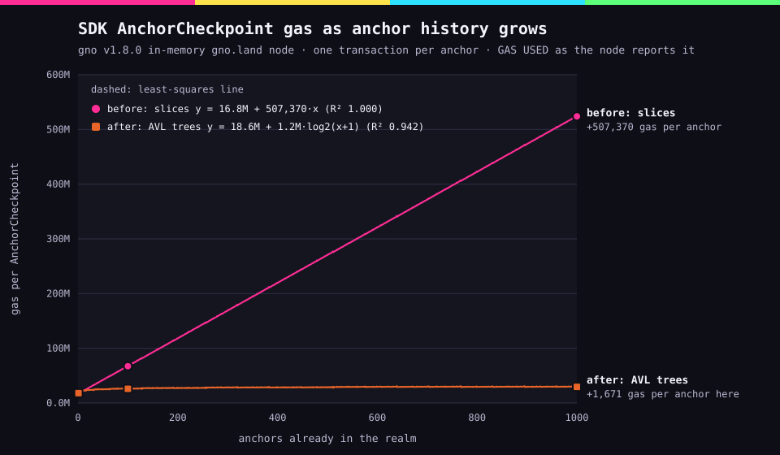

# Gas per AnchorCheckpoint as anchor history grows



The realm used to keep its anchors in a slice of `AnchorRecord` values, and the evidence accumulator kept every leaf in a slice of `[32]byte`. A slice's backing array is one stored object, loaded and saved again in full on every append. Every anchor therefore paid for the realm's whole history.

The anchors are now an AVL tree plus a counter, and the realm's accumulator is a `LedgerAccumulator`: the same RFC 6962 tree, with the same results, its leaves in an AVL tree keyed by index. An append writes O(log n) small nodes. `Accumulator` itself stays the slice, which is cheaper inside a single transaction (agents, MemoryVault and receipt trees use it), and a test holds the two to identical roots, leaves and proofs.

## Results

These are real transactions in an in-memory gno.land node: gno v1.8.0 (`fc79041`), one transaction per anchor, `GAS USED` as the node reports it. Five Pro agents anchor in turn, because an agent's anchors must be at least a block apart. The realm's anchor tree and accumulator grow with every anchor.

| Anchors already in the realm | Before (slices) | After (AVL trees) |
|---:|---:|---:|
| 0 | 15,524,975 | 17,059,755 |
| 1 | 16,651,818 | 17,987,900 |
| 10 | 21,465,945 | 22,481,163 |
| 100 | 67,250,900 | 25,893,392 |
| 500 | 270,350,444 | 28,508,095 |
| 1,000 | 523,930,400 | 29,456,533 |

- **Before** is linear: `y = 16,786,528 + 507,370.3·x`, R² 1.000. Residual RMSE is 368,001 gas and the largest residual 1,382,831.
- **After** is logarithmic, not constant: `y = 18,600,855 + 1,158,830.1·log2(x+1)`, R² 0.942. Residual RMSE is 409,169 gas and the largest residual 1,771,785.
- From 13 prior anchors on, the trees cost less. Below that they cost up to 2.6M gas more (at 5 prior anchors).
- At 1,000 anchors an anchor costs 17.8× less. From 100 to 1,000 anchors the old cost grew 7.8× and the new one 1.14×.
- The separate `LedgerAccumulator` type adds about 0.25M gas to every transaction, compared with a tree-backed `Accumulator`. That is the same at every history size, so it does not change the slope.
- Two runs of each script agree on all but a few anchors, and the cause is verified in the logs. The in-memory node leaves a timing-dependent number of empty blocks between transactions, so an anchor can land at height 99 in one run and 101 in the other. The realm writes heights as decimal text, so an anchor costs more per extra digit of height: 16,984 gas across 100, 1,041 gas across 1,000. Before, 2 of 1,001 anchors differed; after, 24 of 1,001 (the anchors between the two runs' crossings of 1,000), at most 0.07%.

The raw per-anchor gas is in `results/sdk-anchor-gas-{before,after}.json`: entry `i` is anchor `i+1`, which saw `i` prior anchors.

## Reproduce

1. Get the harness.
   ```sh
   git clone --depth 1 --branch v1.8.0 https://github.com/gnolang/gno
   ```
   gno v1.8.0's testscript harness needs two changes to its own test code for this run. Neither touches gas accounting; gno's `compute_map_key_restore_gas.txtar`, which pins an exact `GAS USED`, still passes after them.
   - `gno.land/pkg/integration/testscript_gnoland.go`: `nodeMaxLifespan` is 120 s. 1,001 anchors take about 3-5 minutes, so raise it (we used 2 h).
   - On Windows only, `loadUserEnv` builds the ABCI path with `filepath.Join`, which gives `auth\accounts\<addr>`, and the node answers "unknown request". Use `path + "/" + addr` (as the same file's other query does).
2. Build: `cd gno/gno.land/pkg/integration && go test -c -o integration.test .`
3. Generate the script from this repository at the commit you want to measure:
   ```sh
   node bench/gas/gen-sdk-txtar.mjs <this repo> 1001 after <gno>/gno.land/pkg/integration/testdata/sdk_anchor_gas.txtar
   ```
4. Run. The script ends on a deliberate non-match, so testscript prints every anchor's `GAS USED`:
   ```sh
   GNOROOT=<gno> ./integration.test -test.run 'TestTestdata/sdk_anchor_gas$' -test.v > run.log
   ```
5. Read the curve and draw the chart:
   ```sh
   node bench/gas/gas-curve.mjs run.log after.json
   node bench/gas/gas-chart.mjs before.json after.json chart.svg "SDK AnchorCheckpoint gas as anchor history grows" anchor AnchorCheckpoint
   ```

The scripts measured here:

| File | sha256 |
|---|---|
| `sdk_anchor_gas.txtar`, before | `0d1d5487744a818b937e60cb0fa24323effcd66d7206c2a9f53f6021972bc640` |
| `sdk_anchor_gas.txtar`, after | `6af82dc65bbd3d66cae729c33785a4fd92e2e0451a95fd929217e80dfaeebe86` |
